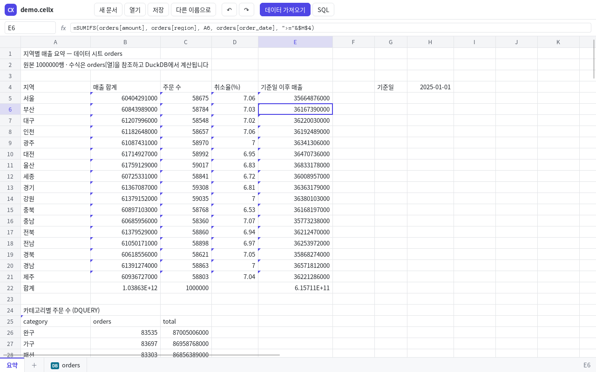

# CellX

엑셀 호환 고성능 스프레드시트.

xlsx를 그대로 열고 저장하는 일반 시트 위에, 수천만 행을 다루는 **데이터 시트**를 붙인 데스크톱 앱입니다. 평소 쓰던 `SUMIFS`, `COUNTIFS`, `XLOOKUP` 같은 수식이 데이터 시트의 1,000만 행에도 그대로 동작합니다.

> 현재 단계: **1단계(엔진 검증) + 첫 프로토타입**입니다. 계획서의 게이트 A(4주 차) 측정을 위한 도구와, 실제로 쓸 수 있는 최소 화면까지 들어 있습니다.




## 구조

```
crates/cellx-core     엔진: IronCalc(계산) + DuckDB(데이터) + 수식→SQL 변환기
crates/cellx-cli      `cellx` 명령: 호환성·성능 측정
apps/desktop          Tauri 2 데스크톱 앱 (React + Canvas 그리드)
```

| 부품 | 역할 |
| --- | --- |
| 계산 엔진 | [IronCalc](https://github.com/ironcalc/IronCalc) (MIT/Apache-2.0). 셀, 수식, xlsx 입출력 |
| 데이터 엔진 | [DuckDB](https://duckdb.org) (MIT). 데이터 시트 저장·조회·집계 |
| 수식→SQL 변환기 | `crates/cellx-core/src/bridge.rs`. 데이터 시트를 참조하는 함수 호출을 SQL로 실행하고 결과를 수식에 넣음 |
| 화면 | Canvas 가상 그리드. 화면에 보이는 셀만 그림 |

### 두 엔진은 이렇게 연결됩니다

```
=ROUND(SUMIFS(orders[amount], orders[region], B1), 0)
        └──────────── DuckDB에서 실행 ────────────┘
        SELECT SUM(CAST("amount" AS DOUBLE)) FROM "orders" WHERE lower(CAST("region" AS VARCHAR)) = lower(?)
=ROUND(184520000, 0)            ← 계산 엔진은 결과만 받음
```

- `B1`처럼 수식 안의 셀 참조는 계산 엔진의 현재 값으로 바뀌어 SQL 파라미터가 됩니다. `B1`이 바뀌면 다시 실행됩니다.
- 같은 SQL과 파라미터의 결과는 캐시합니다. 데이터 시트가 바뀌면 캐시가 무효화됩니다.
- xlsx로 저장하면 결과 값이 들어간 수식(`=ROUND(184520000,0)`)이 저장되므로 Excel에서도 같은 값이 보입니다. 원래 수식과 데이터 시트는 `.cellx` 프로젝트에 저장됩니다.

지원 함수(인수가 `표[열]`일 때): `SUM` `COUNT` `COUNTA` `AVERAGE` `MIN` `MAX` `SUMIF` `COUNTIF` `AVERAGEIF` `SUMIFS` `COUNTIFS` `AVERAGEIFS` `MINIFS` `MAXIFS` `XLOOKUP`, 그리고 쿼리 결과를 시트에 펼치는 `DQUERY("SELECT ...")`.

조건은 Excel 규칙을 따릅니다: `">=100"`, `"<>취소"`, `"*카드*"`(와일드카드), `""`(빈 칸), `">=2025-01-01"`(날짜), 대소문자 무시.

## 빌드

### Windows

1. [Visual Studio Build Tools](https://visualstudio.microsoft.com/visual-cpp-build-tools/) — "C++를 사용한 데스크톱 개발" 워크로드
2. [Rust](https://rustup.rs) (stable), [Node.js 22](https://nodejs.org), `npm i -g pnpm`
3. WebView2 런타임 (Windows 11에는 기본 설치)

```powershell
cd apps\desktop
pnpm install
pnpm tauri dev      # 개발 실행
pnpm tauri build    # 설치 파일: target\release\bundle\msi, nsis
```

### macOS

Xcode Command Line Tools(`xcode-select --install`), Rust, Node.js 22, pnpm을 설치한 뒤 같은 명령을 씁니다. 결과물은 `target/release/bundle/dmg`에 생깁니다.

> 첫 빌드는 DuckDB C++ 소스를 컴파일하므로 10~30분 걸립니다. 이후에는 빠릅니다.

### CI

GitHub Actions(`.github/workflows/ci.yml`)가 push마다 엔진 테스트, 화면 테스트, 호환성 측정을 돌리고, `main`에서는 Windows(msi, exe)와 macOS(dmg) 설치 파일을 만들어 아티팩트로 올립니다.

## 측정 도구 (`cellx`)

```bash
# 1) Excel 호환성: xlsx에 Excel이 저장해 둔 값과 CellX 계산값을 셀 단위로 비교
cargo run --release -p cellx-cli -- compat 내파일들/ --verbose --json compat.json

# 2) 데이터 엔진: 합성 데이터 생성 후 수식→SQL 성능 측정
cargo run --release -p cellx-cli -- gen-data --rows 10000000 -o orders.csv
cargo run --release -p cellx-cli -- bench-data orders.csv

# 3) 계산 엔진: 일반 수식 10만 개 + VLOOKUP 성능
cargo run --release -p cellx-cli -- bench-calc --rows 25000

# xlsx 한 셀의 값 확인
cargo run --release -p cellx-cli -- eval 파일.xlsx "Sheet1!B3"
```

게이트 A 기준(계획서): 실무형 xlsx에서 **수식 일치율 90% 이상**. 실제 업무 파일 대신 직접 만든 실무형 파일과 공개 파일로 측정합니다.

## 측정 결과 (2026-11-21, 1단계)

측정 환경: Linux, 2 vCPU, 8 GB RAM. 개발 빌드(의존성은 `-O2`). 실제 PC(8코어)에서는 더 빠를 것으로 예상하지만 아직 재지 않았습니다.

**Excel 호환성** — IronCalc 저장소의 Excel 생성 xlsx 287개

| 항목 | 결과 |
| --- | --- |
| 수식 셀 | 77,628개 |
| Excel 저장값과 일치 | **98.99%** (불일치 787개) |
| 엔진이 중단된 파일 | 2개 (`DATE_DAY_MONTH_YEAR.xlsx`, `BASE_DECIMAL_issue_1591.xlsx`) |
| 불일치가 많은 영역 | 1900년 전후·1904 날짜 체계, WEEKDAY/WEEKNUM 경계값, BESSEL 정밀도, 함수 인수로 넣은 배열(`CHAR({…})`) |

이 파일들은 IronCalc가 자기 테스트에 쓰는 것이라 결과가 실제보다 좋게 나올 수 있습니다. 게이트 A 판정은 **실무형 파일로 다시 측정한 뒤** 내려야 합니다.

**데이터 엔진** — 합성 주문 데이터 1,000만 행(706 MB CSV)

| 작업 | 시간 |
| --- | --- |
| CSV 가져오기 | 6.0초 (최대 메모리 약 1.1 GB) |
| `SUM(orders[amount])` | 27 ms |
| `SUMIFS` 조건 1개 / 2개(날짜 포함) | 101 ms / 109 ms |
| `COUNTIFS` 와일드카드 | 172 ms |
| `XLOOKUP` | 3 ms |
| `DQUERY` 지역별 GROUP BY | 160 ms |
| 같은 수식 재계산(캐시) | 1 ms 미만 |

계획서 목표(1,000만 행 필터 3초, 집계 5초)를 크게 앞섭니다.

**계산 엔진** — 일반 수식 10만 개

| 작업 | 시간 | 목표 |
| --- | --- | --- |
| 전체 계산 | 116 ms | Excel과 동등 이하 (비교 전) |
| 셀 하나 수정 후 재계산 | 163 ms | 50 ms — **미달** |
| VLOOKUP 2,500개 × 범위 25,000행 | 2.6초 | **느림**, 범위 인덱스 필요 |

IronCalc는 셀 하나를 바꿔도 전체를 다시 계산하고, VLOOKUP은 매번 범위를 처음부터 훑습니다. 2단계에서 가장 먼저 손볼 부분입니다.

## 예제 프로젝트

```bash
cargo run -p cellx-cli -- gen-data --rows 1000000 -o orders.csv
cargo run -p cellx-cli -- make-demo orders.csv -o demo.cellx
# 앱에서 demo.cellx를 열거나, 실행 인수로 넘깁니다
```

## 앱 사용법

- **데이터 가져오기**: CSV, TSV, Parquet을 데이터 시트로 엽니다. 하단 탭에 `DB` 표시로 나타납니다.
- 데이터 시트: 열 머리글 클릭으로 정렬, 위쪽 필터 줄에 Excel 조건(`서울`, `>=100`, `*카드*`)으로 필터, 셀 더블클릭으로 수정.
- 일반 시트에서 `=SUMIFS(orders[amount], orders[region], "서울")`처럼 데이터 시트를 참조합니다. 데이터 엔진이 계산한 셀은 왼쪽 위에 보라색 표시가 있습니다.
- **SQL** 패널: SELECT 결과를 새 데이터 시트로 만듭니다.
- 저장: `.cellx`(데이터 시트 포함) 또는 `.xlsx`(일반 시트만, 데이터 엔진 결과는 값으로).
- 단축키: 방향키, Enter/Tab, F2(편집), Delete, Ctrl+C/V(탭 구분 텍스트, Excel과 호환), Ctrl+Z/Y, Ctrl+S/O/N.

## 보안 원칙

- 데이터는 PC 밖으로 나가지 않습니다. 네트워크를 쓰는 기능이 없습니다.
- DuckDB 확장 자동 설치·로드를 끕니다.
- 사용자 SQL(`DQUERY`, SQL 패널)은 DuckDB 파서로 검사해 **단일 SELECT만** 허용하고, 파일을 읽는 테이블 함수(`read_csv` 등)는 거부합니다.
- 앱 권한은 기본 API와 파일 열기·저장 대화상자로 제한합니다(`apps/desktop/src-tauri/capabilities`).

## 알려진 한계 (프로토타입)

- 계산 엔진은 셀 하나를 바꿔도 전체를 다시 계산합니다(IronCalc 현재 구조). 증분·병렬 재계산은 다음 단계 과제입니다.
- 수식→SQL 변환기의 인수는 문자열, 숫자, 셀 주소, `표[열]`, `&` 연결만 받습니다. 변환기 안에서 다른 함수를 중첩할 수는 없습니다(바깥에서는 가능: `=ROUND(SUMIFS(...),0)`).
- 서식은 굵게, 기울임, 밑줄, 글자색, 채우기, 가로 정렬만 화면에 표시합니다. 테마 색, 테두리, 조건부 서식 표시는 아직입니다.
- 차트, 피벗, VBA는 지원하지 않습니다.
- 행 높이는 고정(24px)입니다.

## 이름

"Excel"은 Microsoft의 상표입니다. CellX는 Microsoft와 관련이 없으며, Excel 파일 형식(xlsx)과 호환됩니다.

## 라이선스

MIT OR Apache-2.0
