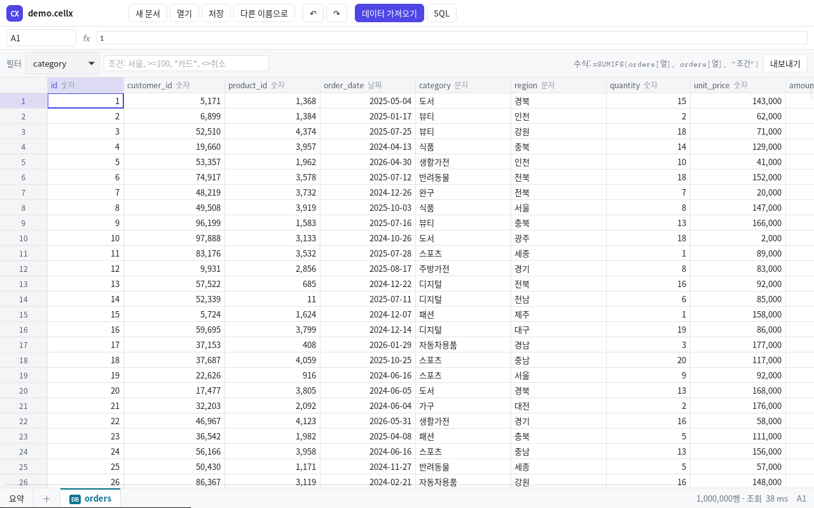

# CellX

엑셀 호환 고성능 스프레드시트.

xlsx를 그대로 열고 저장하는 일반 시트 위에, 수천만 행을 다루는 **붙여넣기 옵션·메모·조건부 서식·차트·피벗**
- 선택하여 붙여넣기(Ctrl+Alt+V, 홈 → 붙여넣기 ▾): 모두/수식/값/서식/열 너비, 연산(더하기·빼기·곱하기·나누기), 내용 있는 셀만, 행/열 바꿈. 행/열 바꿈은 수식의 상대 참조도 Excel처럼 바꿉니다.
- 메모(Shift+F2, 검토 탭, 오른쪽 클릭): 셀 오른쪽 위 빨간 표시, 마우스를 올리면 표시, 「메모 모두 표시」. xlsx 메모로 저장되어 Excel에서 그대로 보입니다.
- 조건부 서식(홈 → 조건부 서식): 셀 강조 규칙(보다 큼·작음·사이·같음·텍스트 포함·중복 값), 상위/하위 규칙, 데이터 막대, 색조, 아이콘 집합, 별점, 규칙 지우기, 규칙 관리. xlsx로 저장·불러오기됩니다.
- 차트(삽입 탭): 세로·가로 막대형, 꺾은선형, 원형, 도넛형, 영역형, 분산형. 셀을 하나만 선택하면 현재 영역으로 만듭니다. 끌어서 이동, 모서리로 크기 조절, 더블클릭(편집), Delete(삭제). 데이터가 바뀌면 바로 다시 그립니다. xlsx 차트로 저장되고, xlsx의 기본 차트는 불러옵니다.
- 피벗 테이블(삽입 → 피벗 테이블): 시트 범위나 데이터 시트를 원본으로 행·열·값(합계, 개수, 평균, 최대, 최소)을 골라 새 시트나 기존 시트에 만듭니다. 계산은 데이터 엔진(DuckDB)이 합니다. 오른쪽 클릭으로 새로 고침·필드 변경·삭제, 데이터 → 모두 새로 고침(Ctrl+Alt+F5). 정의는 .cellx에 저장되고, xlsx에는 결과 값으로 저장됩니다.

**정렬·필터·데이터 도구** (데이터 탭, 홈 → 정렬 및 필터)
- 정렬: 오름차순/내림차순(현재 영역, 머리글 자동 판단), 정렬 대화상자에서 기준 여러 개. 수식의 상대 참조는 행과 함께 움직입니다. 빈 셀은 항상 맨 뒤.
- 자동 필터(Ctrl+Shift+L): 머리글 단추에서 값 목록(검색, 모두 선택), 텍스트/숫자 필터(같음·포함·시작 문자·보다 큼 등 두 조건 그리고/또는), 단추에서 바로 정렬, 지우기, 다시 적용. 상태 표시줄에 「N개 중 M개의 레코드가 있습니다」. xlsx `autoFilter`로 저장·불러오기됩니다.
- 텍스트 나누기: 구분 기호(탭·세미콜론·쉼표·공백·기타, 연속 구분 기호, 텍스트 한정자) 또는 일정한 너비, 미리 보기, 대상 지정.
- 빠른 채우기(Ctrl+E): 옆 열에서 예를 보고 나머지를 채웁니다(단어 추출, 대소문자, 여러 열 합치기 등).
- 중복된 항목 제거: 열 선택, 머리글 표시, 결과 개수 알림.
- 데이터 유효성 검사: 정수·소수점·목록·날짜·시간·텍스트 길이, 설명 메시지, 오류 메시지(중지·경고·정보). 목록은 셀 옆 단추나 Alt+↓로 고릅니다. xlsx `dataValidations`로 저장·불러오기됩니다.
- 가상 분석 → 목표값 찾기.

**윤곽·부분합·표·보호·페이지 레이아웃**
- 그룹(Shift+Alt+→) / 그룹 해제(Shift+Alt+←): 행·열 윤곽, 왼쪽·위쪽 윤곽 기호(수준 단추 1·2·3, +/− 단추), 세부 정보 표시/숨기기, 개요 지우기. xlsx `outlineLevel`로 저장·불러오기됩니다.
- 부분합: 그룹화할 항목, 함수(합계·개수·평균·최대·최소), 계산 항목, 새로운 값으로 대치, 모두 제거. `SUBTOTAL` 행과 총합계를 넣고 윤곽을 만듭니다.
- 표 서식(Ctrl+T, 홈 → 표 서식): Excel 표 스타일(밝게·보통·어둡게), 줄무늬 행, 요약 행, 필터 단추, 표 이름, 범위로 변환. 「표 디자인」 탭은 표 안의 셀을 선택하면 나타납니다. 수식에서 `표1[금액]`처럼 씁니다. xlsx 표로 저장·불러오기됩니다.
- 시트 보호(검토 탭): 암호(Excel과 같은 방식), 허용할 작업(셀·행·열 서식, 행·열 삽입·삭제, 정렬, 자동 필터). 셀 서식 → 보호 → 잠금을 끈 셀만 편집할 수 있습니다. 시트 탭에 🔒 표시.
- 페이지 레이아웃 탭: 용지 방향, 페이지 나누기 삽입·제거·원래대로, 인쇄 제목(반복할 행), 너비 맞춤, 눈금선·제목 인쇄. 페이지 나누기 선을 시트에 표시합니다.

**찾기·이름·링크·인쇄**
- 찾기 및 바꾸기(Ctrl+F, Ctrl+H): 대/소문자 구분, 전체 셀 내용 일치, 시트/통합 문서 범위, 바꾸기, 모두 바꾸기(수식 포함).
- 이름 관리자(Ctrl+F3), 이름 정의, 이름 상자에 이름을 입력하면 선택 영역의 이름이 됩니다. 수식에서 `=단가*3`처럼 씁니다.
- 하이퍼링크(Ctrl+K): 웹 페이지, 현재 문서의 셀, 전자 메일. 클릭하면 열립니다(누르고 있으면 셀 선택). 앱은 http·https·mailto 주소만 엽니다.
- 인쇄(Ctrl+P, 파일 → 인쇄): 미리 보기와 페이지 넘기기, 활성 시트/선택 영역, 용지 방향, 배율(너비 맞춤·한 페이지), 인쇄 제목, 눈금선·머리글, 바닥글 페이지 번호. Excel처럼 아래로 먼저 나누고, 수동 페이지 나누기를 따르며, 차트도 인쇄됩니다. 인쇄 창의 「PDF로 저장」으로 PDF를 만듭니다.

**데이터 시트**를 붙인 데스크톱 앱입니다. 평소 쓰던 `SUMIFS`, `COUNTIFS`, `XLOOKUP` 같은 수식이 데이터 시트의 1,000만 행에도 그대로 동작합니다.

> 현재 단계: **1단계(엔진 검증) + 첫 프로토타입**입니다. 계획서의 게이트 A(4주 차) 측정을 위한 도구와, 실제로 쓸 수 있는 최소 화면까지 들어 있습니다.




## 구조

```
crates/cellx-core     엔진: IronCalc(계산) + DuckDB(데이터) + 수식→SQL 변환기
crates/cellx-cli      `cellx` 명령: 호환성·성능 측정
apps/desktop          Tauri 2 데스크톱 앱 (React + Canvas 그리드)
```

| 부품 | 역할 |
| --- | --- |
| 계산 엔진 | [IronCalc](https://github.com/ironcalc/IronCalc) (MIT/Apache-2.0). 셀, 수식, xlsx 입출력 |
| 데이터 엔진 | [DuckDB](https://duckdb.org) (MIT). 데이터 시트 저장·조회·집계 |
| 수식→SQL 변환기 | `crates/cellx-core/src/bridge.rs`. 데이터 시트를 참조하는 함수 호출을 SQL로 실행하고 결과를 수식에 넣음 |
| 화면 | Canvas 가상 그리드. 화면에 보이는 셀만 그림 |

### 두 엔진은 이렇게 연결됩니다

```
=ROUND(SUMIFS(orders[amount], orders[region], B1), 0)
        └──────────── DuckDB에서 실행 ────────────┘
        SELECT SUM(CAST("amount" AS DOUBLE)) FROM "orders" WHERE lower(CAST("region" AS VARCHAR)) = lower(?)
=ROUND(184520000, 0)            ← 계산 엔진은 결과만 받음
```

- `B1`처럼 수식 안의 셀 참조는 계산 엔진의 현재 값으로 바뀌어 SQL 파라미터가 됩니다. `B1`이 바뀌면 다시 실행됩니다.
- 같은 SQL과 파라미터의 결과는 캐시합니다. 데이터 시트가 바뀌면 캐시가 무효화됩니다.
- xlsx로 저장하면 결과 값이 들어간 수식(`=ROUND(184520000,0)`)이 저장되므로 Excel에서도 같은 값이 보입니다. 원래 수식과 데이터 시트는 `.cellx` 프로젝트에 저장됩니다.

지원 함수(인수가 `표[열]`일 때): `SUM` `COUNT` `COUNTA` `AVERAGE` `MIN` `MAX` `SUMIF` `COUNTIF` `AVERAGEIF` `SUMIFS` `COUNTIFS` `AVERAGEIFS` `MINIFS` `MAXIFS` `XLOOKUP`, 그리고 쿼리 결과를 시트에 펼치는 `DQUERY("SELECT ...")`.

조건은 Excel 규칙을 따릅니다: `">=100"`, `"<>취소"`, `"*카드*"`(와일드카드), `""`(빈 칸), `">=2025-01-01"`(날짜), 대소문자 무시.

## 빌드

Rust 빌드는 저장소 루트에서 `cargo build --workspace`처럼 항상 `--workspace`로 하세요. `-p`로 크레이트 하나만 빌드하면 DuckDB의 기능 조합이 달라져 처음부터 다시 컴파일합니다(수 분). 계산 엔진 IronCalc는 Excel 기본값(맑은 고딕 11pt 등)과 편집 기능에 맞춰 일부 고친 사본을 `vendor/ironcalc_base`에 두고 씁니다. 고친 내용은 `vendor/ironcalc_base/VENDORED.md`에 있습니다.

### Windows

1. [Visual Studio Build Tools](https://visualstudio.microsoft.com/visual-cpp-build-tools/) — "C++를 사용한 데스크톱 개발" 워크로드
2. [Rust](https://rustup.rs) (stable), [Node.js 22](https://nodejs.org), `npm i -g pnpm`
3. WebView2 런타임 (Windows 11에는 기본 설치)

```powershell
cd apps\desktop
pnpm install
pnpm tauri dev      # 개발 실행
pnpm tauri build    # 설치 파일: target\release\bundle\msi, nsis
```

### macOS

Xcode Command Line Tools(`xcode-select --install`), Rust, Node.js 22, pnpm을 설치한 뒤 같은 명령을 씁니다. 결과물은 `target/release/bundle/dmg`에 생깁니다.

> 첫 빌드는 DuckDB C++ 소스를 컴파일하므로 10~30분 걸립니다. 이후에는 빠릅니다.

### CI

GitHub Actions(`.github/workflows/ci.yml`)가 push마다 엔진 테스트, 화면 테스트, 호환성 측정을 돌리고, `main`에서는 Windows(msi, exe)와 macOS(dmg) 설치 파일을 만들어 아티팩트로 올립니다.

### 릴리스

```bash
node scripts/bump-version.mjs 0.2.0      # Cargo.toml·Cargo.lock·tauri.conf.json·package.json 버전을 한 번에
git commit -am "v0.2.0" && git tag v0.2.0
git push && git push origin v0.2.0
```

태그를 푸시하면 `.github/workflows/release.yml`이 태그와 앱 버전이 같은지 확인하고, 엔진 테스트 후 설치 파일을 빌드해 **GitHub Release 초안**에 올립니다. 초안을 확인하고 「Publish」를 누르면 공개됩니다(0.x 버전은 사전 릴리스로 표시).

| 파일 | 용도 |
| --- | --- |
| `CellX_x.y.z_x64-setup.exe` | Windows 권장. 관리자 권한 없이 사용자 계정에 설치, 한국어 설치 화면 |
| `CellX_x.y.z_x64_ko-KR.msi` | Windows 관리자·그룹 정책 배포용 |
| `CellX_x.y.z_universal.dmg` | macOS (Apple Silicon·Intel 공용) |
| `SHA256SUMS.txt` | 설치 파일 체크섬 |

WebView2가 없는 PC(오래된 Windows 10)에서는 설치 중에 자동으로 받아 설치합니다(인터넷 필요). 앱 버전은 파일 탭 → 정보에 표시됩니다.

**코드 서명**: 저장소 비밀값에 인증서를 넣으면 릴리스 워크플로가 자동으로 서명합니다(Windows: PFX 또는 Azure Key Vault, macOS: Developer ID + 공증). 비밀값이 없으면 서명 없이 빌드합니다. 인증서 종류, 비용, 설정 방법은 [docs/code-signing.md](docs/code-signing.md)에 정리했습니다. 서명된 파일도 SmartScreen 평판이 쌓일 때까지는 경고가 뜰 수 있습니다.

## 측정 도구 (`cellx`)

```bash
# 1) Excel 호환성: xlsx에 Excel이 저장해 둔 값과 CellX 계산값을 셀 단위로 비교
cargo run --release -p cellx-cli -- compat 내파일들/ --verbose --json compat.json

# 2) 데이터 엔진: 합성 데이터 생성 후 수식→SQL 성능 측정
cargo run --release -p cellx-cli -- gen-data --rows 10000000 -o orders.csv
cargo run --release -p cellx-cli -- bench-data orders.csv

# 3) 계산 엔진: 일반 수식 10만 개 + VLOOKUP 성능
cargo run --release -p cellx-cli -- bench-calc --rows 25000

# 4) 큰 일반 시트 작업: 저장·열기·화면 그리기·정렬·필터·행 삽입·서식·복사/붙여넣기·찾기
cargo run --release -p cellx-cli -- bench-sheet --rows 100000

# xlsx 한 셀의 값 확인
cargo run --release -p cellx-cli -- eval 파일.xlsx "Sheet1!B3"
```

게이트 A 기준(계획서): 실무형 xlsx에서 **수식 일치율 90% 이상**. 실제 업무 파일 대신 직접 만든 실무형 파일과 공개 파일로 측정합니다.

## 측정 결과 (2026-11-21, 1단계)

측정 환경: Linux, 2 vCPU, 8 GB RAM. 개발 빌드(의존성은 `-O2`). 실제 PC(8코어)에서는 더 빠를 것으로 예상하지만 아직 재지 않았습니다.

**Excel 호환성** — IronCalc 저장소의 Excel 생성 xlsx 287개

| 항목 | 결과 |
| --- | --- |
| 수식 셀 | 77,628개 |
| Excel 저장값과 일치 | **98.99%** (불일치 787개) |
| 엔진이 중단된 파일 | 2개 (`DATE_DAY_MONTH_YEAR.xlsx`, `BASE_DECIMAL_issue_1591.xlsx`) |
| 불일치가 많은 영역 | 1900년 전후·1904 날짜 체계, WEEKDAY/WEEKNUM 경계값, BESSEL 정밀도, 함수 인수로 넣은 배열(`CHAR({…})`) |

이 파일들은 IronCalc가 자기 테스트에 쓰는 것이라 결과가 실제보다 좋게 나올 수 있습니다. 게이트 A 판정은 **실무형 파일로 다시 측정한 뒤** 내려야 합니다.

**데이터 엔진** — 합성 주문 데이터 1,000만 행(706 MB CSV)

| 작업 | 시간 |
| --- | --- |
| CSV 가져오기 | 6.0초 (최대 메모리 약 1.1 GB) |
| `SUM(orders[amount])` | 27 ms |
| `SUMIFS` 조건 1개 / 2개(날짜 포함) | 101 ms / 109 ms |
| `COUNTIFS` 와일드카드 | 172 ms |
| `XLOOKUP` | 3 ms |
| `DQUERY` 지역별 GROUP BY | 160 ms |
| 같은 수식 재계산(캐시) | 1 ms 미만 |

계획서 목표(1,000만 행 필터 3초, 집계 5초)를 크게 앞섭니다.

**계산 엔진** — 일반 수식 10만 개

| 작업 | 시간 | 목표 |
| --- | --- | --- |
| 작업 | 2026-11-21 | 2026-11-22 | 목표 |
| --- | --- | --- | --- |
| 전체 계산 | 116 ms | 75~180 ms | Excel과 동등 이하 (비교 전) |
| 셀 하나 수정 후 재계산 | 163 ms | **0.01 ms 미만** | 50 ms — **달성** |
| VLOOKUP 2,500개 × 범위 25,000행 | 2.6초 | **20 ms** | 달성 |

**큰 일반 시트** — 10만 행 × 8열(값 60만, 수식 20만), 릴리스 빌드, 2026-11-22

| 작업 | 처음 | 1차 개선 | 2차 개선 | 조치 |
| --- | --- | --- | --- | --- |
| 셀 하나 수정 + 재계산 | 0.16초 | 0.19초 | **0.01 ms** | 증분 재계산(의존성 인덱스) |
| 열거나 구조를 바꾼 뒤 첫 수정 | | | 0.13초 | 의존성 인덱스를 한 번 만듦 |
| 맨 위에 행 삽입 | 24.5초 | 2.1초 | **0.4초** | 셀을 그대로 옮기고 참조는 해석된 수식에서 조정 |
| 행 삽입 실행 취소 / 행 삭제 | | 약 2초 | **0.4초** | 〃 |
| 자동 필터 | 6.5초 | 0.6초 | 0.6~0.9초 | 행 정보 이진 탐색(패치 10) |
| 정렬 (키 2개) / 실행 취소 | 5.1초 / 2.1초 | 1.8초 / 0.4초 | 같음 | 서식 인덱스 비교, 같은 셀 건너뜀 |
| xlsx 저장 (5.0 MB) / 열기 | 0.9초 / 2.4초 | 0.9초 / 1.9초 | 같음 | |
| 화면 한 장(50행×20열) | 1.2 ms | 0.6 ms | 같음 | |

**계산 엔진** — VLOOKUP 2,500개 × 범위 2.5만 행: 2.6초 → **20 ms**. 10만 행 범위에 5,000개도 0.1초입니다. 한 번의 계산 안에서 조회 범위를 한 번만 읽고 정확히 일치용 해시 인덱스를 만듭니다(VLOOKUP·HLOOKUP·MATCH).

측정할 때마다 VM 속도가 1.5배 정도 달라서 같은 작업도 실행마다 차이가 있습니다. 표의 「2차 개선」 열은 같은 날 같은 VM에서 잰 값입니다.

증분 재계산은 이렇게 동작합니다.
- 수식이 읽는 셀·범위로 역방향 인덱스를 만들고, 바뀐 셀에서 시작해 영향받는 수식만 계산합니다.
- INDIRECT·OFFSET·NOW·RAND·이름 정의를 쓰는 수식은 휘발성으로 보고 매번 계산합니다.
- 여러 칸으로 넘치는 배열 수식이 있거나, 행·열·시트 구조를 바꾸거나, 수식의 절반 이상이 영향을 받으면 전체를 계산합니다.
- 증분 결과가 전체 계산과 같은지는 `crates/cellx-core/tests/incremental.rs`에서 매 단계 비교합니다.

**데이터 엔진** 재측정(100만 행, 68.6 MB, DuckDB 2.0.1): 가져오기 0.42초, SUM 2.4 ms, SUMIFS 6~8 ms, COUNTIFS 와일드카드 11.5 ms, DQUERY GROUP BY 9 ms.

## 예제 프로젝트

```bash
cargo run -p cellx-cli -- gen-data --rows 1000000 -o orders.csv
cargo run -p cellx-cli -- make-demo orders.csv -o demo.cellx
# 앱에서 demo.cellx를 열거나, 실행 인수로 넘깁니다
```

## 앱 사용법

화면과 조작은 Excel과 같게 맞췄습니다. 기본 글꼴은 맑은 고딕 11pt, 열 너비 8.43(72px), 행 높이 16.5pt(22px)로 한국어판 Excel 기본값과 같습니다. 강조색은 Excel의 초록 대신 CellX의 남색을 씁니다.

**수식 입력**
- `=` 다음에 셀을 클릭하거나 드래그하면 참조가 들어갑니다(참조 모드). 방향키, Shift+방향키로도 됩니다. 다른 시트 탭을 눌러 `Sheet2!A1`처럼 다른 시트를 참조할 수 있습니다.
- 참조마다 색이 다르고 같은 색 테두리가 시트에 표시됩니다. F4는 `$A$1 → A$1 → $A1 → A1`을 차례로 바꿉니다.
- 함수 이름을 치면 목록이 나오고 Tab으로 고릅니다. F2는 입력/편집 모드를 바꿉니다(편집 모드에서는 방향키가 글자 사이를 움직입니다).
- Enter/Shift+Enter, Tab/Shift+Tab(Tab으로 옮긴 뒤 Enter를 누르면 시작한 열로 돌아감), Ctrl+Enter(선택 범위 전체에 입력), Alt+Enter(셀 안 줄바꿈), Esc(취소).
- 데이터 시트 탭을 눌러 열을 클릭하면 `표[열]` 참조가 들어갑니다.

**단축키**
- 이동: Ctrl+방향키(데이터 끝), Ctrl+Shift+방향키, Home, Ctrl+Home, Ctrl+End, PageUp/PageDown, Alt+PageUp/PageDown, Ctrl+PageUp/PageDown(시트), Ctrl+G·F5(이름 상자)
- 선택: Shift+Space(행), Ctrl+Space(열), Ctrl+A(현재 영역 → 전체)
- 편집: F2, Delete, Backspace, Ctrl+D, Ctrl+R, Ctrl+;(날짜), Ctrl+Shift+;(시간), Alt+=(자동 합계), Ctrl+C/X/V(Excel과 텍스트 호환, 앱 안에서는 수식 참조 이동), 복사 후 Enter(붙여넣기), Ctrl+Z/Y
- 서식: Ctrl+B/I/U, Ctrl+5(취소선), Ctrl+1(셀 서식), Ctrl+Shift+1/3/4/5/~(숫자/날짜/통화/백분율/일반), Ctrl+Shift+>/<(글꼴 크기)
- 행·열: Ctrl++ / Ctrl+-(삽입/삭제), Ctrl+9 / Ctrl+0(숨기기), Ctrl+Shift+9 / 0(숨기기 취소), Shift+F11(새 시트)
- 파일: Ctrl+N/O/S, F12(다른 이름으로 저장), Ctrl+F/H(찾기)

**마우스**: 채우기 핸들 드래그(연속 데이터·수식 채우기), 열·행 경계 드래그와 더블클릭(자동 맞춤), 머리글·셀 오른쪽 클릭 메뉴, Ctrl+휠 확대/축소, 시트 탭 더블클릭(이름 바꾸기). 여러 셀을 선택하면 상태 표시줄에 평균, 개수, 합계가 나옵니다.

**데이터 시트**
- 데이터 탭 → 「데이터 가져오기」로 CSV, TSV, Parquet을 데이터 시트로 엽니다. 하단 탭에 `DB` 표시로 나타납니다.
- 열 머리글 클릭으로 정렬, 아래쪽 필터 줄에 Excel 조건(`서울`, `>=100`, `*카드*`)으로 필터, 셀 더블클릭으로 수정.
- 일반 시트에서 `=SUMIFS(orders[amount], orders[region], "서울")`처럼 데이터 시트를 참조합니다. 데이터 엔진이 계산한 셀은 오른쪽 위에 남색 표시가 있습니다.
- **SQL** 패널: SELECT 결과를 새 데이터 시트로 만듭니다.
- 저장: `.cellx`(데이터 시트 포함) 또는 `.xlsx`(일반 시트만, 데이터 엔진 결과는 값으로).

## 보안 원칙

- 데이터는 PC 밖으로 나가지 않습니다. 네트워크를 쓰는 기능이 없습니다.
- DuckDB 확장 자동 설치·로드를 끕니다.
- 사용자 SQL(`DQUERY`, SQL 패널)은 DuckDB 파서로 검사해 **단일 SELECT만** 허용하고, 파일을 읽는 테이블 함수(`read_csv` 등)는 거부합니다.
- 앱 권한은 기본 API와 파일 열기·저장 대화상자로 제한합니다(`apps/desktop/src-tauri/capabilities`).

## 알려진 한계 (프로토타입)

- 여러 칸으로 넘치는 동적 배열(FILTER, SORT 등)이 있는 통합 문서는 증분 재계산 없이 매번 전체를 계산합니다. 병렬 재계산은 아직 없습니다.
- 열 삽입·삭제는 아직 예전(문자열) 방식이라 큰 시트에서 행보다 느립니다.
- 수식→SQL 변환기의 인수는 문자열, 숫자, 셀 주소, `표[열]`, `&` 연결만 받습니다. 변환기 안에서 다른 함수를 중첩할 수는 없습니다(바깥에서는 가능: `=ROUND(SUMIFS(...),0)`).
- VBA(매크로)는 지원하지 않습니다.
- 표의 구조적 참조(`표1[금액]`)는 입력할 때 실제 범위로 바뀌어 저장됩니다(IronCalc 방식). 표에 행을 추가해도 기존 수식의 범위는 늘어나지 않습니다.
- 셀 잠금 해제는 xlsx에 「편집 가능 범위」(protectedRanges)로 저장됩니다. Excel에서 연 파일의 잠금 해제 셀은 불러옵니다.
- 한글 암호는 Excel과 해시가 다를 수 있습니다(영문·숫자 암호 권장).
- 통합 문서 보호, 시트 보기(사용자 지정 보기), 매크로는 지원하지 않습니다.
- xlsx로 저장한 피벗 테이블은 Excel에서 일반 셀(값)로 보입니다. 피벗 정의는 .cellx 프로젝트에만 남습니다.
- 차트는 기본 서식만 저장합니다(계열 색, 제목, 범례). Excel에서 꾸민 세부 서식(3차원, 추세선, 보조 축)은 불러올 때 기본 모양으로 바뀝니다.

## 이름

"Excel"은 Microsoft의 상표입니다. CellX는 Microsoft와 관련이 없으며, Excel 파일 형식(xlsx)과 호환됩니다.

## 라이선스

MIT OR Apache-2.0
